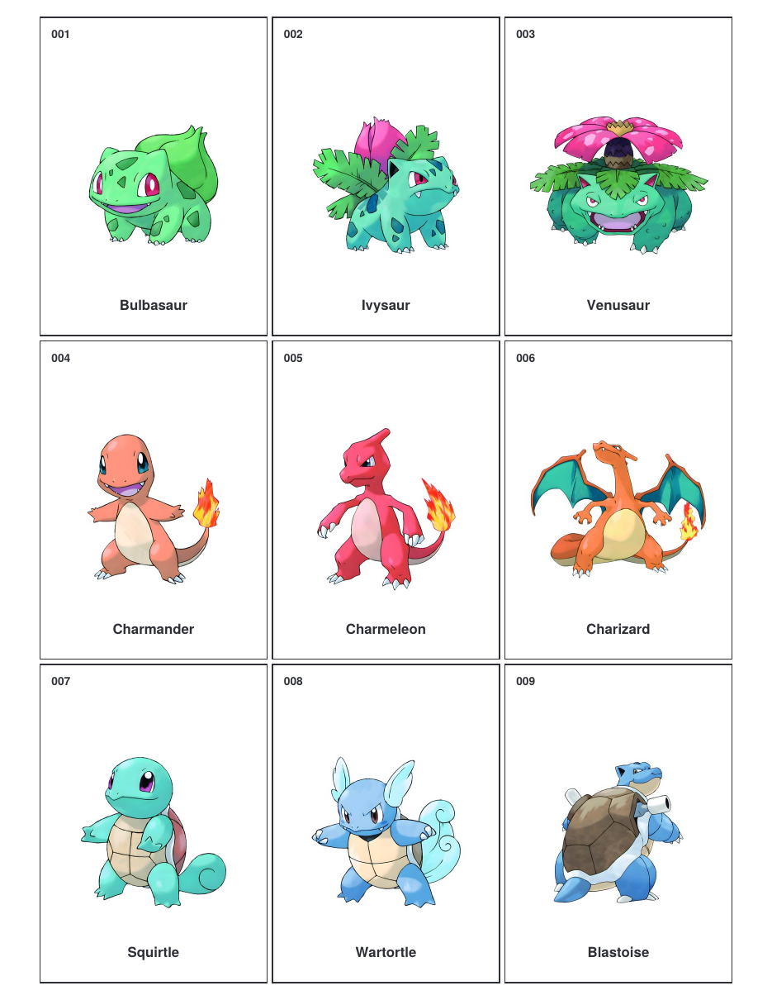

# pokemon-151-binder-placeholders

English | [简体中文](README.zh-CN.md)

A free, print-ready set of placeholder cards for all 151 original Pokémon. Print it, cut it out, and slot each card into your binder so every pocket shows exactly which card still goes there.

**[Download the PDF](pokemon-151-binder-placeholders.pdf)** (18 pages, 4.3 MB)



## The problem

If you collect Pokémon cards, you know the feeling: you decide to complete the original 151, you buy a binder, and then it sits there mostly empty. You can't remember which pocket is meant for which Pokémon, and the gaps don't tell you what you're still missing.

The usual fix is placeholder cards: print one for every Pokémon, cut them out, and put them in the pockets. As you pull the real card, it replaces the placeholder.

When I went looking for a set, the ones I found on Etsy cost money. For a sheet of paper you print at home, that felt wrong. So I made my own and I'm giving it away.

## What's inside

- **All 151 Pokémon**, #001 Bulbasaur to #151 Mew, in National Dex order.
- **Real card size**: each placeholder is 63.5 × 88.9 mm (2.5 × 3.5 in), the same as a trading card, so it fits any binder pocket or toploader.
- **9 cards per page**, laid out like a 9-pocket binder page: one printed page = one binder page.
- **Number, name and artwork** on every card, so you can spot gaps at a glance.
- **Works on US Letter and A4.** Margins are safe for both.
- A cover page with printing instructions.

## How to print

1. Open the PDF and print at **100% / "Actual size"**. Do **not** use "Fit to page", or the cards will shrink.
2. US Letter or A4 both work. Color or black-and-white.
3. Regular paper is fine; cardstock sits flatter in the sleeve.
4. Cut along the borders and slot them in.

Tip: you only need to print the pages for the cards you don't have yet.

## Files

```
pokemon-151-binder-placeholders.pdf   # The printable (cover + 17 pages of cards)
assets/
├── cover.png                         # Cover preview
└── preview.png                       # Page 1 preview
```

## Disclaimer

This is a free, fan-made resource for personal use. It is not affiliated with, endorsed or sponsored by Nintendo, Creatures Inc., GAME FREAK or The Pokémon Company. Pokémon names and artwork are trademarks and © of their respective owners. Please don't sell this file or printed copies of it.

## License

See [LICENSE](LICENSE).
