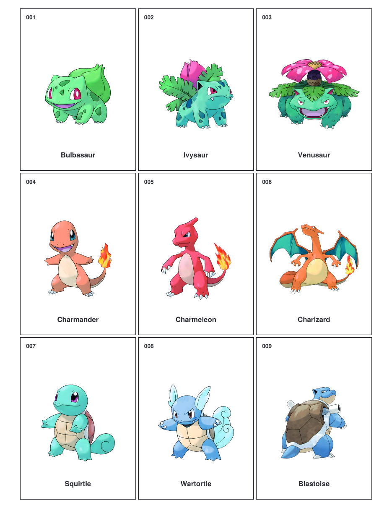

# pokemon-151-binder-placeholders

[English](README.md) | 简体中文

一份免费、可直接打印的初代 151 只宝可梦卡册占位卡。打印、裁剪、插进卡册，每个卡位都能看出这里该放哪张卡。

**[下载 PDF](pokemon-151-binder-placeholders.pdf)**（18 页，4.3 MB）



## 痛点

玩宝可梦卡的人大多有过这种经历：决定收齐初代 151，卡册买回来了，里面却大半空着。哪个格子该放哪只记不住，空位也看不出自己还缺什么。

常见的办法是先放占位卡：每只宝可梦打印一张，剪下来插进卡位，抽到真卡就替换掉。

我上网找现成的，结果 Etsy 上的居然要收费。一张在家就能打印的纸还要花钱，我觉得没必要，就自己做了一份，免费给大家下载。

## 里面有什么

- **全部 151 只**，从 #001 妙蛙种子到 #151 梦幻，按全国图鉴顺序排列。
- **真卡尺寸**：每张 63.5 × 88.9 mm（2.5 × 3.5 英寸），和实体卡一样大，任何卡册格子或硬卡套都能放。
- **每页 9 张**，排法和 9 格卡册页一致：打印一页就对应卡册一页。
- 每张卡都有**编号、名字和图**，一眼看出缺哪张。
- **US Letter 和 A4 都能打**，页边距两种纸都安全。
- 附一页封面，写了打印说明。

## 怎么打印

1. 打开 PDF，按 **100% / 实际大小** 打印，**不要**选"适合页面"，否则卡会缩小。
2. US Letter 或 A4 都行，彩打黑白都可以。
3. 普通纸就行，卡纸放进卡套更平整。
4. 沿边框剪下，插进卡册。

小技巧：只打印你还缺的那几页就够了。

## 文件

```
pokemon-151-binder-placeholders.pdf   # 打印文件（封面 + 17 页卡片）
assets/
├── cover.png                         # 封面预览
└── preview.png                       # 第 1 页预览
```

## 声明

这是免费的粉丝自制资源，仅供个人使用，与任天堂、Creatures、GAME FREAK 及 The Pokémon Company 无关，也未获其授权或赞助。宝可梦名称和图片的商标与版权归各自权利人所有。请勿出售本文件或打印成品。

## 许可

见 [LICENSE](LICENSE)。
